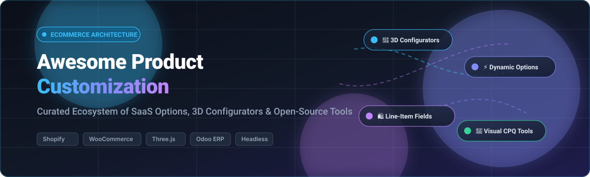

# 🎨 Awesome Product Customization 🛍️
### ✨ Top Product Options, 3D Configurators & Personalization Ecosystem 🚀

  
  
  
  
  
  
  

> 🌟 **Awesome Product Customization** is a comprehensive, SEO-optimized curated index of enterprise SaaS platforms, 3D visual configurators, CPQ frameworks, and open-source GitHub repositories for **Product Options**, **Custom Fields**, **Web-to-Print**, and **Visual Personalization Workflows** across Shopify, WooCommerce, PrestaShop, Odoo ERP, VTEX, and Headless architectures.

📅 *Last updated: October 2026.*

---

## 📑 Table of Contents

- [📊 Sector Overview & Market Dynamics](#-sector-overview--market-dynamics)
- [☁️ SaaS / Hosted Platforms](#️-saas--hosted-platforms)
- [💻 Open-Source GitHub Projects](#-open-source-github-projects)
  - [Repositories (Ranked by GitHub_Stars)](#-repositories-ranked-by-github-stars)
- [⚙️ Headless Libraries & Native Toolkits](#️-headless-libraries--native-toolkits)
- [⭐ Star History](#-star-history)
- [💖 Support & Sponsorship](#-support--sponsorship)
- [🤝 How to Contribute](#-how-to-contribute)
- [⚠️ Disclaimer](#️-disclaimer)

---

## 📊 Sector Overview & Market Dynamics

The global product customization and configurator software market is valued at approximately **$1.28 billion to $1.5 billion** (scaling toward **$5.14+ billion by 2030** when paired with broader AI-driven dynamic personalization and CPQ engines at a 15–23% CAGR), embedded within a massive **$100B+** mass-customization and on-demand print/manufacturing ecosystem. 📈

Market dynamics remain **moderately fragmented and platform-asymmetric rather than winner-take-all**: native platform constraints (such as Shopify's historical 3-option/100-variant limit) created a resilient long tail of specialized third-party app developers and boutique visual CPQ tools, though roll-up aggregators (e.g., Shop Circle acquiring Bold and HulkApps tools) and platform-level API evolutions are steadily driving consolidation at the enterprise tier. 🌐

---

## ☁️ SaaS / Hosted Platforms

Below is a curated comparison of leading hosted SaaS product customization platforms, sorted by parent company scale (revenue / valuation descending). 🏆

| Product | Developer / Parent Company | Company Scale (Revenue / Valuation) | Starting Tier Pricing | Free Tier / Trial Limit | Key Capabilities & Architecture |
| :--- | :--- | :--- | :--- | :--- | :--- |
| **[Shopify Line-Item Properties](https://help.shopify.com/en/manual/online-store/themes/customizing-themes)** | Shopify Inc. (NYSE: SHOP) | ~$12.18B TTM Revenue / ~$215B–$224B Market Cap | $0/mo (Included in Shopify plans starting at $39/mo) | Free forever on any active Shopify store (zero extra app fees) | Core native form properties (`properties[...]`) stored directly on order line items; basic text/file fields without conditional logic or upcharges. |
| **[Bold Product Options](https://apps.shopify.com/product-options)** | Shop Circle (acquired from Bold Commerce) | ~$43M–$45M ARR / ~$305M+ Total Capital Raised | $14.99/mo (Basic Plan) | 14-day free trial on live stores; free indefinitely on Shopify Partner development stores | Custom option sets, text inputs, radio buttons, file uploads; $39.99/mo tier unlocks conditional logic and price upcharges. |
| **[Hulk Product Options](https://apps.shopify.com/hulk-product-options)** | HulkApps / Shop Circle | ~$11.6M–$19.1M ARR (Parent acquired / aggregated) | $10.00/mo (Basic Plan) | 7-day free trial; free access restricted to Shopify Partner development stores | 12+ input types, color/image swatches, file uploads, formula-based options, and Shopify B2B catalog support. |
| **[Infinite Options](https://apps.shopify.com/custom-options)** | ShopPad Inc. | Privately held SaaS (~$5M–$10M est. ARR; $500K Seed) | $12.99/mo (Essential Plan) | 14-day free trial across all features | Unlimited options, dropdowns, radio buttons, conditional visibility, number inputs, and product bundling. |
| **[Kickflip](https://gokickflip.com/)** | Kickflip (formerly MyCustomizer) | ~$2.3M ARR / Early VC-backed (~$50K+ seed) | $59.00/mo (Base plan) | 14-day free trial (no credit card required upfront) | Real-time multi-component visual configurator, full-page/modal embeds, live color/texture mapping, and translation support. |
| **[Zepto Product Personalizer](https://apps.shopify.com/product-personalizer)** | Zepto Apps | Bootstrapped SaaS (~$1M–$3M est. ARR) | $9.99/mo (Starter Plan) | 15-day free trial (no permanent free tier on live stores) | Live visual preview on canvas/product images, 22+ option inputs, layer-based graphics, and font selection. |
| **[Variant Option Product Options](https://apps.shopify.com/variant-option-product-options)** | Relentless Apps | Bootstrapped SaaS (~$500K–$1.5M est. ARR) | $9.99/mo (Basic Plan) | Free forever plan strictly limited to 1 product; 14-day free trial on paid plans | Unlimited options on 1 product for free; paid tier unlocks unlimited products, conditional logic, and add-on pricing. |
| **[Customify](https://apps.shopify.com/customify)** | Customify | Bootstrapped SaaS (~$300K–$800K est. ARR) | $10.00/mo (Lite Plan) | Free forever tier limited to 3 custom products, 3 paid custom orders/mo, and 256MB file storage (14-day trial on paid tiers) | Drag-and-drop web-to-print personalizer, custom artwork/photo uploads, and print-ready vector/raster exports. |
| **[King Product Options](https://apps.shopify.com/king-product-options)** | YMQ | Bootstrapped SaaS (~$200K–$600K est. ARR) | $0.00/mo (Free Core App) | Free forever with unlimited products and unlimited options | Free tier includes swatches, file upload fields, text inputs, option templates, and conditional display rules. |

---

## 💻 Open-Source GitHub Projects

Open-source product customization repositories sorted descending by GitHub Stars_Count. Each entry links to the official repository and includes an interactive social Stars_Badge linking directly to the repo's stargazers. 🌟

### Repositories (Ranked by GitHub_Stars)

- **[threejs-3d-room-designer](https://github.com/CodyMQ/threejs-3d-room-designer)**   
  *Stack: React.js, Three.js, WebGL*  
  Comprehensive browser-based 3D room planner and modular product configurator. Demonstrates real-time texture mapping, dynamic material swaps, spatial dimension scaling, and 3D scene customization for home goods and interior fixtures. 🛋️

- **[pledra/odoo-product-configurator](https://github.com/pledra/odoo-product-configurator)**   
  *Stack: Python, Odoo ERP*  
  The foundational open-source Odoo framework enabling dynamic product configuration, multi-attribute dependencies, dynamic bill-of-materials (BOM) creation, and automated variant pricing. ⚙️

- **[Industry-Product-Configurator](https://github.com/Unity-Technologies/Industry-Product-Configurator)**   
  *Stack: Unity, C#, WebGL / Multi-platform*  
  Lightweight industrial product configurator framework authored by Unity Technologies. Supports visibility toggling, material variants, camera preset transitions, and transform animations for complex mechanical, automotive, and industrial goods. 🚗

- **[cup-demo](https://github.com/iosorin/cup-demo)**   
  *Stack: Nuxt.js, Three.js, Fabric.js*  
  Full-featured interactive 3D product customizer combining Three.js 3D viewport rendering with Fabric.js 2D canvas editing. Allows shoppers to apply personalized text, decals, and graphics with live 3D wrap previews. ☕

- **[threejs-t-shirt](https://github.com/Starklord17/threejs-t-shirt)**   
  *Stack: React, Three.js, Vite, Tailwind CSS*  
  Interactive 3D t-shirt customization web app with real-time color picking, custom logo image uploads, and full-surface procedural pattern generation rendered via Three.js. 👕

- **[OCA/product-configurator](https://github.com/OCA/product-configurator)**   
  *Stack: Python, Odoo ERP*  
  Enterprise-grade Odoo dynamic product configurator maintained by the Odoo Community Association (OCA). Handles complex multi-level attribute dependencies, dynamic bill-of-materials (BOM) generation, and real-time sales price calculation. 📦

- **[PululuK/democustomfields17](https://github.com/PululuK/democustomfields17)**   
  *Stack: PHP, PrestaShop*  
  PrestaShop module implementation demonstrating native custom product fields, file uploads, text personalization attributes, and persistence across customer cart and checkout workflows. 🏬

- **[woocommerce-product-customizer](https://github.com/marcusig/woocommerce-product-customizer)**   
  *Stack: PHP, WordPress, WooCommerce*  
  WooCommerce product configurator and visual customization engine allowing shoppers to configure physical goods with real-time live preview layers prior to cart addition. 🎨

- **[react-product-configurator](https://github.com/mbpictures/react-product-configurator)**   
  *Stack: React, JavaScript, CSS3*  
  Modular React visual product configurator featuring multi-part product option selection, live image layer compositing, and price recalculation. 🧩

- **[3d-product-configurator](https://github.com/Madewill/3d-product-configurator)**   
  *Stack: React, React Three Fiber, Three.js*  
  Modern 3D product configurator demonstrating interactive mesh material swaps, color palette pickers, and dynamic lighting presets on 3D GLTF models. 👟

- **[customizr](https://github.com/carolineschnapp/customizr)**   
  *Stack: JavaScript, Liquid, Shopify Theme Architecture*  
  Pioneering open-source Shopify customization module designed by Caroline Schnapp. Demonstrates headless line-item properties injection, dynamic custom form elements, and file upload handlers for bespoke order details. 🛍️

- **[vtex-apps/product-customizer](https://github.com/vtex-apps/product-customizer)**   
  *Stack: TypeScript, React, VTEX IO*  
  Official VTEX IO storefront product customizer app. Renders dynamic assembly options, attachment items, text personalization fields, and complex add-on services directly integrated into VTEX checkout. 🔌

- **[uploadcare-custom-shopify-theme](https://github.com/yablochki95/uploadcare-custom-shopify-theme)**   
  *Stack: Liquid, JavaScript, Uploadcare API*  
  Custom Shopify theme with seamless Uploadcare integration for advanced customer file uploads, high-res image manipulation, and media validation for print-on-demand and engraving products. 📸

- **[friends-of-presta/products](https://github.com/friends-of-presta/products)**   
  *Stack: PHP, PrestaShop 1.7 / 8*  
  Community-maintained PrestaShop product customization module delivering extended custom fields, text engraving validations, and order item attachments. 🛒

- **[snelgraveren-product-designer](https://github.com/temmink/snelgraveren-product-designer)**   
  *Stack: PHP, JavaScript, Canvas, WooCommerce*  
  Drag-and-drop web-to-print and laser-engraving designer for WooCommerce. Supports custom SVG text pathing, bitmap photo uploads, bounding-box constraints, and print-ready vector/raster exports. 🖨️

---

## ⚙️ Headless Libraries & Native Toolkits

- **[product-variants-core](https://www.npmjs.com/package/product-variants-core)**  
  *Stack: TypeScript / Node.js*  
  Type-safe JavaScript/TypeScript core library for headless CPQ and variant logic. Generates valid variant permutations, enforces JSON conditional constraint rules (e.g., mutually exclusive options), and computes dynamic price modifiers. 🧩

- **[Shopify Hydrogen getProductOptions](https://shopify.dev/docs/api/hydrogen)**  
  *Stack: TypeScript, React, Hydrogen*  
  Official Shopify Hydrogen utility for headless storefronts to parse and resolve complex product options, option values, and variant permutations beyond standard storefront constraints. ⚡

- **[shopify-mcp](https://github.com/ishandutta2007/Awesome-Product-Customization)**  
  *Stack: TypeScript, Model Context Protocol (MCP)*  
  Automation layer and MCP server for the Shopify Admin API facilitating automated product options and variant generation via LLM agents. 🤖

---

## ⭐ Star History

---

## 💖 Support & Sponsorship

Thank you so much for exploring and using this repository! 🙏 If you find this curated directory useful for your ecommerce store, client projects, or technical research, please consider supporting the project:

- ⭐ **Star this repository** to help others discover it
- 🍴 **Fork it** and contribute new tools or updates
- 📢 **Share it** with fellow merchants, architects, and theme developers
- ☕ **Buy me a coffee / sponsor ongoing maintenance**: Support via the [GitHub Sponsors Dashboard](https://github.com/sponsors/ishandutta2007)

Every contribution and star is deeply appreciated! 🌟

---

## 🤝 How to Contribute

Contributions to expand this curated list are welcome! 🚀

1. Fork the repository.
2. Add your SaaS product or open-source repository into the appropriate section.
3. For open-source entries, ensure you include:
   - Name and direct GitHub link
   - Social Stars_Badge (`style=social&color=white`) linking directly to the repo's `/stargazers`
   - Primary tech stack and 1–2 factual description sentences
4. For SaaS entries, supply accurate pricing and transparent free-tier/trial terms.
5. Submit a Pull Request with a concise summary of additions.

---

## ⚠️ Disclaimer

- This repository is a community-maintained curated educational directory and does not constitute commercial endorsement.
- All product names, trademarks, and registered trademarks are property of their respective owners.
- Security note: Production customization engines handling uploaded files and personalized user input must enforce strict file format whitelisting, antivirus/malware scanning, and PII protection compliance (GDPR/CCPA).
